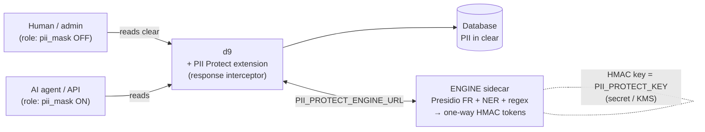

# Architecture — d9 PII Protect

Two bricks, decoupled by an environment variable. **One engine per environment** (dev / staging / prod):
no central proxy, PII never leaves its environment.

The model is **output masking**: the database stays in clear and RBAC decides *access*; this extension
decides, *per role*, whether PII is **masked on the way out** of the API. It **complements RBAC — it does
not replace it**. The goal is to keep PII out of an AI agent's prompts and traces (protect the agent from
itself), not to defend against a deliberately hostile user.

```
                        ENVIRONMENT (dev / staging / prod)
  ┌──────────────────────────────────────────────────────────────────────────┐
  │   AI agent / API ─────────┐  (role with pii_mask = ON)                     │
  │                            ▼                                                │
  │                    ┌───────────────┐   PII_PROTECT_ENGINE_URL   ┌────────┐ │
  │   Human / admin ──▶│      d9       │ ──── strings to mask ─────▶ │ ENGINE │ │
  │   (role OFF =      │  + extension  │ ◀──── [TYPE:hash] tokens ─── │(sidecar)│ │
  │    sees clear)     │  PII Protect  │                             └────────┘ │
  │                    └───────┬───────┘                        Presidio FR     │
  │                            │                                + FR NER + regex │
  │                            ▼                                + HMAC (one-way) │
  │                        Database  (PII IN CLEAR, access gated by RBAC)        │
  └──────────────────────────────────────────────────────────────────────────┘
```



## Who does what

| Brick | Role | Tech | Repo contents |
|---|---|---|---|
| **Engine** (`engine/`) | Detects PII in a string and replaces each value with a one-way token. One-way only — no decryption. | Python, [Presidio](https://microsoft.github.io/presidio/) + FR NER [Anonym-IA](https://huggingface.co/Anonym-IA/V2-camembert-ner-pii-french) + regex/checksum recognizers + HMAC | `Dockerfile`, `app.py`, `analyzer.py`, `recognizers.py`, `ner.py`, `crypto.py`, `image_redact.py`, `MODELS.md` |
| **Extension** (`extension/`) | One job: mask PII on the way out of the d9 API, for roles flagged `pii_mask`. A single response interceptor + binary asset redaction. | TypeScript (d9 hook) | `src/index.ts`, `dist/index.js` |
| **Deploy** (`deploy/`) | Reference stack wiring the two together. | docker-compose | `docker-compose.yml`, `.env.example` |

## The flow, step by step

1. A request comes in. d9 authenticates it and resolves `req.accountability` (the **role**).
2. The extension wraps `res.json`. For a role with **`pii_mask` ON**, it takes the whole response body
   (items, GraphQL, aggregates, aliases, nested relations, file metadata — everything), collects its unique
   string values and sends them to the engine's `POST /anonymize-batch` in **one round trip**.
3. The engine **detects** PII (FR NER + regex + Presidio context scoring) and replaces each detected value
   with a **consistent keyed token** `[TYPE:hash]` (HMAC — same value → same token, so joins/dedup still
   work, but no way back to the clear).
4. Binary files requested via `/assets` are redacted on the fly (text hashed, image/PDF masked, unknown
   type refused). Bulk export (`?export=csv`, `/utils/export`) streams outside `res.json`, so it is **refused
   (403)** for masked roles.
5. A role with **`pii_mask` OFF** (humans, admin, unconfigured roles) reads **normally** — the DB is in clear.
6. **Fail-closed**: if the engine is unreachable, the masked role gets `503 PII masking unavailable`, never
   the clear value.

## Detection — division of labour

| Class | Detector | Why |
|---|---|---|
| Names, organisations (open sets) | **NER (Anonym-IA)** | No pattern exists for an arbitrary name; only a model reading context catches them. |
| Formatted + verifiable IDs: NIR, SIREN/SIRET (Luhn), IBAN (mod-97), card, email, IP, phone, dates | **regex + checksum** | Deterministic shape + validity check → 100% precise, fast, explainable. Better than ML here. |
| Address, postal code, city | **regex + gazetteer** | The model has the labels but barely predicts them — a *stopgap* until a better FR model. City list is case-sensitive and postal is only matched next to a known city, to avoid masking arbitrary numbers. |

Overlap resolution keeps the **longest** span first, so a full match (whole phone/address) wins over a
shorter NER fragment — PII is never left half-masked.

## Design decisions

- **Output masking, role-level, admin-controlled**: one boolean `pii_mask` on `directus_roles`, editable on
  the role page like any permission — so **only users who can edit roles** change what is masked. Applies to
  **any role, humans included**. By scanning the response **by value** at a single choke point (`res.json`),
  coverage is uniform across REST / GraphQL / aggregates / aliases / nested relations — no route-by-route holes.
- **One-way, not reversible**: tokens are keyed HMAC. There is no decryption endpoint and no write-path, so
  there is **no decryption oracle** and no risk of corrupting data on write. The DB stays clear, so authorized
  roles re-identify simply by reading with a non-masked role.
- **Complements RBAC**: RBAC decides *who can access what*; this decides *whether PII is shown* to a role that
  does have access. It is **not** a hard confidentiality boundary (see *Known limitations* in the README).
- **One engine per environment**: confinement. No central proxy through which every environment's data transits.
- **No custom logs**: activity is already tracked by d9's native audit.

## Customizable points (flagged in the code)

- Add a **regex** / recognizer → `engine/recognizers.py`.
- Change the **NER model** (other language/model) → env `PII_NER_MODEL`, see `engine/MODELS.md`.
- Choose **which PII types** are masked → `PII_PROTECT_ENTITIES` / `PII_PROTECT_SKIP`.
- Extend the **city gazetteer** → `_CITIES` in `engine/recognizers.py`.
