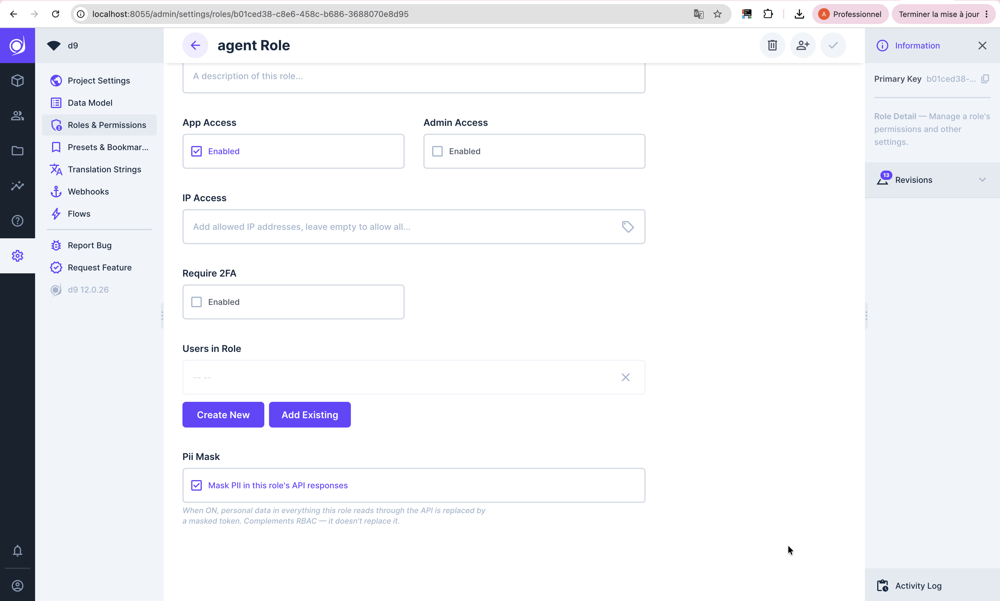

# d9 PII Protect

Hide personal data from the roles you choose, in [d9](https://github.com/LaWebcapsule/d9).

Turn on one switch for a role, and every piece of personal data that role reads — names, emails, phone
numbers, social-security / company numbers, addresses… — is automatically replaced by a token like
`[NOM_PERSONNE:a3f9c2]`. Every other role keeps seeing the real values, and the database itself is never
changed. It works across the whole d9 API (REST, GraphQL, file downloads).

The typical use: let an **AI agent** work with your data without real PII ever landing in its prompts or logs.

Detection is French-first and runs in a small engine next to d9, so your data never leaves your environment.
It **complements** d9's permissions — it doesn't replace them. See [Known limitations](#known-limitations).

## 🤖 Set it up with AI

New to this? Open a ready-made setup guide in your favorite AI — it reads this repo and walks you through adding the extension to your d9 / Directus, step by step:

[](https://chatgpt.com/?q=Help%20me%20install%20the%20%22d9%20PII%20Protect%22%20extension%20on%20my%20EXISTING%20d9%20or%20Directus%20instance%20so%20that%2C%20for%20the%20roles%20I%20choose%2C%20personal%20data%20%28PII%29%20is%20masked%20in%20the%20API%20responses%20while%20other%20roles%20still%20see%20the%20real%20values.%20The%20project%3A%20https%3A%2F%2Fgithub.com%2FLaWebcapsule%2Fd9-pii-protect%20%E2%80%94%20read%20its%20README%20and%20extension%2FREADME.md%20first.%20Then%20guide%20me%20step%20by%20step%20for%20MY%20setup%20%28ask%20how%20my%20d9%2FDirectus%20runs%20%E2%80%94%20Docker%3F%20how%20is%20it%20deployed%3F%20%E2%80%94%20before%20any%20command%29%3A%0A1%29%20Start%20the%20detection%20engine%20sidecar%20%28Docker%20image%20built%20from%20the%20repo%27s%20engine%2F%20folder%3B%20set%20PII_PROTECT_KEY%29%20and%20note%20its%20URL.%0A2%29%20Add%20the%20extension%20to%20my%20extensions%2F%20folder%20%28use%20the%20prebuilt%20extension%2Fdist%2Findex.js%2C%20or%20run%20npm%20install%20%26%26%20npm%20run%20build%29.%0A3%29%20Point%20the%20extension%20at%20the%20engine%20via%20the%20PII_PROTECT_ENGINE_URL%20env%20var.%0A4%29%20Restart%20%E2%80%94%20it%20should%20log%20%22%5Bpii-protect%5D%20loaded%22%20and%20auto-create%20a%20%22Mask%20PII%22%20toggle%20on%20roles.%0A5%29%20Open%20a%20role%20%28Settings%20%3E%20Roles%20%26%20Permissions%29%20and%20turn%20on%20%22Mask%20PII%20in%20this%20role%27s%20API%20responses%22.%0AVerify%3A%20read%20data%20as%20a%20user%20of%20that%20role%20%28PII%20appears%20as%20%5BTYPE%3Ahash%5D%20tokens%29%20vs%20an%20admin%20%28clear%29.) [](https://claude.ai/new?q=Help%20me%20install%20the%20%22d9%20PII%20Protect%22%20extension%20on%20my%20EXISTING%20d9%20or%20Directus%20instance%20so%20that%2C%20for%20the%20roles%20I%20choose%2C%20personal%20data%20%28PII%29%20is%20masked%20in%20the%20API%20responses%20while%20other%20roles%20still%20see%20the%20real%20values.%20The%20project%3A%20https%3A%2F%2Fgithub.com%2FLaWebcapsule%2Fd9-pii-protect%20%E2%80%94%20read%20its%20README%20and%20extension%2FREADME.md%20first.%20Then%20guide%20me%20step%20by%20step%20for%20MY%20setup%20%28ask%20how%20my%20d9%2FDirectus%20runs%20%E2%80%94%20Docker%3F%20how%20is%20it%20deployed%3F%20%E2%80%94%20before%20any%20command%29%3A%0A1%29%20Start%20the%20detection%20engine%20sidecar%20%28Docker%20image%20built%20from%20the%20repo%27s%20engine%2F%20folder%3B%20set%20PII_PROTECT_KEY%29%20and%20note%20its%20URL.%0A2%29%20Add%20the%20extension%20to%20my%20extensions%2F%20folder%20%28use%20the%20prebuilt%20extension%2Fdist%2Findex.js%2C%20or%20run%20npm%20install%20%26%26%20npm%20run%20build%29.%0A3%29%20Point%20the%20extension%20at%20the%20engine%20via%20the%20PII_PROTECT_ENGINE_URL%20env%20var.%0A4%29%20Restart%20%E2%80%94%20it%20should%20log%20%22%5Bpii-protect%5D%20loaded%22%20and%20auto-create%20a%20%22Mask%20PII%22%20toggle%20on%20roles.%0A5%29%20Open%20a%20role%20%28Settings%20%3E%20Roles%20%26%20Permissions%29%20and%20turn%20on%20%22Mask%20PII%20in%20this%20role%27s%20API%20responses%22.%0AVerify%3A%20read%20data%20as%20a%20user%20of%20that%20role%20%28PII%20appears%20as%20%5BTYPE%3Ahash%5D%20tokens%29%20vs%20an%20admin%20%28clear%29.) [](https://www.perplexity.ai/search?q=Help%20me%20install%20the%20%22d9%20PII%20Protect%22%20extension%20on%20my%20EXISTING%20d9%20or%20Directus%20instance%20so%20that%2C%20for%20the%20roles%20I%20choose%2C%20personal%20data%20%28PII%29%20is%20masked%20in%20the%20API%20responses%20while%20other%20roles%20still%20see%20the%20real%20values.%20The%20project%3A%20https%3A%2F%2Fgithub.com%2FLaWebcapsule%2Fd9-pii-protect%20%E2%80%94%20read%20its%20README%20and%20extension%2FREADME.md%20first.%20Then%20guide%20me%20step%20by%20step%20for%20MY%20setup%20%28ask%20how%20my%20d9%2FDirectus%20runs%20%E2%80%94%20Docker%3F%20how%20is%20it%20deployed%3F%20%E2%80%94%20before%20any%20command%29%3A%0A1%29%20Start%20the%20detection%20engine%20sidecar%20%28Docker%20image%20built%20from%20the%20repo%27s%20engine%2F%20folder%3B%20set%20PII_PROTECT_KEY%29%20and%20note%20its%20URL.%0A2%29%20Add%20the%20extension%20to%20my%20extensions%2F%20folder%20%28use%20the%20prebuilt%20extension%2Fdist%2Findex.js%2C%20or%20run%20npm%20install%20%26%26%20npm%20run%20build%29.%0A3%29%20Point%20the%20extension%20at%20the%20engine%20via%20the%20PII_PROTECT_ENGINE_URL%20env%20var.%0A4%29%20Restart%20%E2%80%94%20it%20should%20log%20%22%5Bpii-protect%5D%20loaded%22%20and%20auto-create%20a%20%22Mask%20PII%22%20toggle%20on%20roles.%0A5%29%20Open%20a%20role%20%28Settings%20%3E%20Roles%20%26%20Permissions%29%20and%20turn%20on%20%22Mask%20PII%20in%20this%20role%27s%20API%20responses%22.%0AVerify%3A%20read%20data%20as%20a%20user%20of%20that%20role%20%28PII%20appears%20as%20%5BTYPE%3Ahash%5D%20tokens%29%20vs%20an%20admin%20%28clear%29.)

<details><summary>Or copy the prompt</summary>

```text
Help me install the "d9 PII Protect" extension on my EXISTING d9 or Directus instance so that, for the roles I choose, personal data (PII) is masked in the API responses while other roles still see the real values. The project: https://github.com/LaWebcapsule/d9-pii-protect — read its README and extension/README.md first. Then guide me step by step for MY setup (ask how my d9/Directus runs — Docker? how is it deployed? — before any command):
1) Start the detection engine sidecar (Docker image built from the repo's engine/ folder; set PII_PROTECT_KEY) and note its URL.
2) Add the extension to my extensions/ folder (use the prebuilt extension/dist/index.js, or run npm install && npm run build).
3) Point the extension at the engine via the PII_PROTECT_ENGINE_URL env var.
4) Restart — it should log "[pii-protect] loaded" and auto-create a "Mask PII" toggle on roles.
5) Open a role (Settings > Roles & Permissions) and turn on "Mask PII in this role's API responses".
Verify: read data as a user of that role (PII appears as [TYPE:hash] tokens) vs an admin (clear).
```

</details>

## Install

Add it to an **existing d9** — see [`extension/README.md`](extension/README.md) — or run the reference
stack from scratch:

```bash
cd deploy
cp .env.example .env            # set at least PII_PROTECT_KEY
docker compose up -d --build    # d9 on http://localhost:8055 + the PII engine
```

## Use it

Open **Settings → Roles & Permissions → a role** and turn on **Mask PII in this role's API responses**.



That's it. Everyone in that role now reads every text field (short or long) with its personal data masked;
other roles are unaffected. Numbers and other non-text fields are left to d9's own permissions. Turning the
switch requires role-edit rights, so a regular user can't change what's masked.

## Configuration (environment variables)

| Variable | Where | What | Default |
|---|---|---|---|
| `PII_PROTECT_KEY` | engine | Secret key for the one-way HMAC tokens (use a secret/KMS in production). No default — the engine refuses to start without it. | — (required) |
| `PII_PROTECT_ENGINE_URL` | extension | URL of the engine. | `http://engine:8077` |
| `PII_PROTECT_ENGINE_TOKEN` | engine + extension | Optional shared secret; if set, the engine only accepts calls carrying it (`X-Engine-Token`). | *(empty = no auth)* |
| `PII_PROTECT_ENTITIES` / `PII_PROTECT_SKIP` | engine | Allow-list / deny-list of PII types to mask. | *(empty = all)* |
| `PII_NER_MODEL` | engine | Hugging Face NER model (see [`engine/MODELS.md`](engine/MODELS.md)). | Anonym-IA FR |
| `PII_NER_THRESHOLD` | engine | NER confidence threshold. | `0.4` |
| `PII_NER_ONNX_THREADS` | engine | ONNX Runtime threads (empty = auto; cap to perf cores on Apple Silicon). | *(auto)* |
| `PII_HASH_LEN` | engine | Hex length of the token hash. | `12` |
| `PII_OCR_LANG` | engine | Tesseract language for image redaction. | `fra` |

## Customize

- Add a regex / recognizer → `engine/recognizers.py`.
- Change language / model → `PII_NER_MODEL` (candidates in `engine/MODELS.md`).
- Choose which PII types → `PII_PROTECT_ENTITIES` / `PII_PROTECT_SKIP`.

Architecture overview: [`ARCHITECTURE.md`](ARCHITECTURE.md).

## Known limitations

This is **output masking that complements RBAC**, not encryption-at-rest. It reduces exposure of *detected*
PII to a *non-hostile* role across every HTTP read path. By design it does **not** cover:

- **A deliberately hostile role.** The database stores clear and still filters/sorts on the clear value, so a
  role that *actively* probes (`filter[field][_starts_with]=…`, binary-searching a value) can reconstruct it.
  Blocking that is the job of **RBAC** (don't grant the field) or encryption-at-rest.
- **PII coming *in*.** Only what *leaves* the API is masked; a role can still *write* clear PII to the database.
- **Data at rest.** A DB dump, direct SQL, an admin, or any unconfigured role sees the clear value — that's the point.
- **Non-string fields.** Only string values are scanned. PII placed in a numeric/boolean column isn't masked
  (use RBAC/field permissions there). Long text *is* handled — the engine chunks it.
- **WebSocket / realtime.** Messages are pushed outside the HTTP response path, so they aren't scrubbed.
  Realtime is **off by default**; keep it off for masked roles (or add a service-layer hook if you enable it).
- **Detection is best-effort.** Names, emails, phones, NIR/SIREN/SIRET/IBAN, dates, and addresses/postal/city
  (via FR recognizers) are covered; but the city gazetteer only knows the largest communes, phone numbers
  spelled out in words aren't caught, and complex/non-UTF-8 documents may redact imperfectly. Whatever the
  engine doesn't detect leaks — improving recognizers is ongoing, and everything masked is already more than a
  bare d9.

## License

MIT — see [LICENSE](LICENSE).
